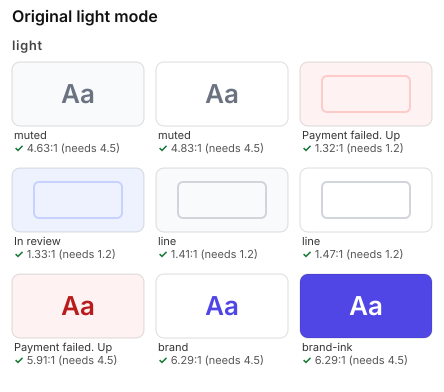
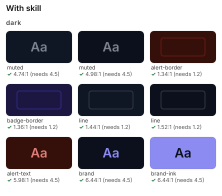

<h1>
  <picture>
    <source media="(prefers-color-scheme: dark)" srcset="docs/logo-dark.png">
    <source media="(prefers-color-scheme: light)" srcset="docs/logo-light.png">
    
  </picture>
</h1>

Accessible, perception-based UI color for AI coding agents.

## The problem

Ask an AI agent to "add a dark mode" or "make my brand color accessible" and it will usually write hex codes by hand. They often look fine, but nobody has measured them. Text can fall short of its contrast target on a raised surface, a dark mode can feel flatter than the light one, brand hues drift, and web projects get old sRGB hex instead of wide-gamut color. Agents also tend to build a full 50–900 scale for every hue when the app needs a handful of colors with clear jobs, and pick red and green error and success colors that look the same to color-blind people.

Chromagentic is a skill that fixes this. The agent describes the colors it wants, and a color engine builds them to exact contrast targets in every mode.

## What it looks like

Same prompt, "Add a dark mode", on a project that only had a light theme. ✓ means the color pair meets its contrast target.

| Original light mode | New dark mode, without the skill | New dark mode, with the skill |
|---|---|---|
|  |  |  |

More examples, including dark-to-light, button states, and mood prompts like "calm and earthy", are in the [gallery](docs/gallery/README.md).

## Measured improvement

The evals start a real agent (GitHub Copilot CLI or Claude Code) on 17 typical requests across sample projects (plain CSS, Tailwind, design tokens, SwiftUI, Android Compose, and new apps), with and without the skill, and grade the finished project with code that's separate from the engine.

The headline is a **core score**: outcomes any good answer should reach, such as contrast in every needed mode as an sRGB screen shows it, colors a screen can show, a working build, and the task's own goals (color-blind-safe feedback, visible focus rings, a new mode that keeps the original's look). The skill's own style choices, such as OKLCH syntax, are reported apart. Each difference comes with a 95% interval, so you can tell a real gain from chance.

**New numbers are coming.** The 0.3.0 table scored the skill's preferred color format as part of the result, so a correct answer in hex lost points. That overstated the gap, and it's been taken down until the evals are run again with the new method. Method and how to run them: [evals/README.md](evals/README.md).

## Install

```sh
npx skills add NateBaldwinDesign/Chromagentic
```

This works for most agents (GitHub Copilot, Claude Code, Cursor, Codex, Gemini, and others). Or use your agent's own installer:

| Tool | Install | Update | Remove |
|---|---|---|---|
| Skills CLI (any agent) | `npx skills add NateBaldwinDesign/Chromagentic` | `npx skills update chromagentic` | `npx skills remove chromagentic` |
| GitHub CLI | `gh skill install NateBaldwinDesign/Chromagentic chromagentic` | `gh skill update chromagentic` | Delete the `chromagentic` skill folder |
| GitHub Copilot CLI | `copilot plugin install NateBaldwinDesign/Chromagentic` | `copilot plugin update chromagentic` | `copilot plugin uninstall chromagentic` |
| Claude Code | `/plugin marketplace add NateBaldwinDesign/Chromagentic`, then `/plugin install chromagentic@chromagentic` | `/plugin marketplace update chromagentic` | `/plugin uninstall chromagentic` |

To stay on one release, pin it: `gh skill install NateBaldwinDesign/Chromagentic chromagentic@v0.3.0`.

If your project already lists `chromagentic` as an npm dev dependency, `npx skills experimental_sync -y` links the skill from `node_modules` (experimental).

The skill includes its own copy of the engine (`scripts/chromagentic.mjs`), so it works offline with just Node.js 22 or newer.

After that, just ask your agent for color work, for example "Create a color system for this app", "Add dark mode", or "Give my app a calm, earthy feel".

## What it does

Chromagentic gives your agent two things:

1. **A skill**: practical color knowledge for user interfaces (perception, contrast, scales, modes, accessibility, platforms), rewritten from [Color and Contrast.com](https://colorandcontrast.com).
2. **A color engine**: exact colors made from contrast targets, so your agent never has to guess. Every color has a known contrast in every mode.

UI colors start from **semantic roles**, not a full value scale: text in up to three tiers (subtle ≈4.5:1, strong ≈7.5:1, strongest ≈12:1), borders at 3:1, an accent at 3:1 or more whose lightness follows the brand's hue, text on the accent at 4.5:1, and interaction states in small, even steps. A fuller scale is added only when the project needs it.

New apps get **six schemes** (light and dark, each with low, regular, and high contrast), wired to the project's own theme switch. **Feedback colors** (error, success, warning, info) start in harmony with the brand and are adjusted until every pair stays clearly different (CIEDE2000 ΔE ≥ 11) for people with protan, deutan, and tritan color blindness. If you want people to **personalize** their colors, the agent asks first, then adds a small script that rebuilds the same roles from each person's lightness and contrast choice.

Colors are measured the way people see them (OKLCH). Light, dark, high-contrast, and low-contrast modes come from a few global settings. Dark modes get extra contrast to make up for light text on dark looking weaker (polarity compensation, 10% by default). When converting an existing theme, the agent reuses its colors as key colors so the original mode keeps its look.

## Generate colors yourself

Write a settings file, for example `chromagentic.theme.json`:

```json
{
  "$schema": "https://raw.githubusercontent.com/NateBaldwinDesign/Chromagentic/v0.3.0/skills/chromagentic/assets/theme.schema.json",
  "colors": { "brand": "#0265dc" },
  "modes": {
    "light": { "backgroundLightness": 1 },
    "dark": { "backgroundLightness": 0.1 }
  }
}
```

Then generate:

```sh
npx chromagentic generate chromagentic.theme.json --out src/colors.css
```

Useful options:

- `--format css|tailwind|dtcg|json`: CSS custom properties (the default), a Tailwind v4 `@theme`, design tokens (DTCG), or all the data.
- `--platform ios|android|web|email|…`: picks the right gamut and format for the platform (see below).
- `--strict`: fail (exit code 3) when there are warnings, such as a contrast target that can't be reached. Notes never fail.
- `--json`: print one JSON object with `ok`, `errors`, `warnings` (each with a `code`), `notes`, and `output`.

Other commands:

```sh
npx chromagentic validate chromagentic.theme.json # check settings and list warnings, no colors printed
npx chromagentic suggest "calm and earthy"     # candidate key colors for mood words
npx chromagentic describe "#c8a03c"            # "bright, earthy and playful"
npx chromagentic contrast "#767676" "#ffffff"  # 4.54
npx chromagentic feedback "#6d28d9"            # error, success, warning, info that suit the brand
npx chromagentic check-cvd "#d03030" "#3a9a30" # are these distinct for color-blind people?
```

See [`skills/chromagentic/assets/`](skills/chromagentic/assets) for more settings files, including all four kinds of mode and APCA.

## Settings for each mode

| Setting | What it does | Typical values |
|---|---|---|
| `backgroundLightness` | How light the background is | `1` light, `0.1` dark |
| `contrastMultiplier` | Scales every contrast target | `1` normal, `1.5`–`2` high contrast, `0.7`–`0.85` low contrast |
| `polarityCompensation` | Extra contrast on dark backgrounds (WCAG 2 only) | `0.1` (default) |

Contrast can use **WCAG 2** (the default) or **APCA** (`"formula": "apca"`).

## Platforms and gamut

| Platform | Output |
|---|---|
| Modern web CSS, Tailwind, design tokens | OKLCH, wide gamut |
| iOS, macOS, visionOS, Android Compose | Display P3 |
| Email, Flutter, React Native, older tech | sRGB hex |

## JavaScript API

```js
import { generateTheme, toCss, toDtcg, suggestColors, describeColor, contrast, checkCvd } from "chromagentic";

const theme = generateTheme({ colors: { brand: "#0265dc" } });
theme.modes.light.roles.text;   // { css, hex, oklch, contrast, target, ref }
theme.warnings;                 // targets that couldn't be reached, in plain words

const css = toCss(theme);       // CSS custom properties for every mode
const tokens = toDtcg(theme);   // DTCG design tokens

suggestColors("bright vivid").colors; // candidate key colors
describeColor("#c8a03c").summary;     // "bright, earthy and playful"
contrast("#767676", "#fff");          // 4.54 (WCAG 2)
checkCvd({ error: "#d03030", success: "#3a9a30" }).pass; // false: too close for color-blind people
```

For personal colors in the browser, `chromagentic/runtime` rebuilds the same roles from a lightness and contrast choice and writes them as CSS variables (about 90 KB, 35 KB gzipped):

```js
import { createPersonalizer, personalize } from "chromagentic/runtime";
personalize(settings, { backgroundLightness: 0.15, contrast: 1.3 });

// For sliders: check the settings once and reuse recent results.
const personalizer = createPersonalizer(settings);
slider.oninput = () => personalizer.apply({ backgroundLightness: Number(slider.value) });
```

The words-to-colors data is English and written from a Western point of view. Treat it as a starting point, not a rule.

## Not included yet

Data-visualization palettes and transparent (opacity) colors.

## Development

```sh
npm install
npm test               # unit and property tests
npm run test:coverage  # coverage report (90% goal)
npm run lint && npm run typecheck && npm run build
npm run eval           # agent evals (uses AI credits; see evals/README.md)
```

## License and credits

Apache-2.0. The color engine is adapted from the Spectrum Studio color system (Copyright Adobe, Apache-2.0). Color conversion uses [colorjs.io](https://colorjs.io) (MIT). See [NOTICE](NOTICE).
