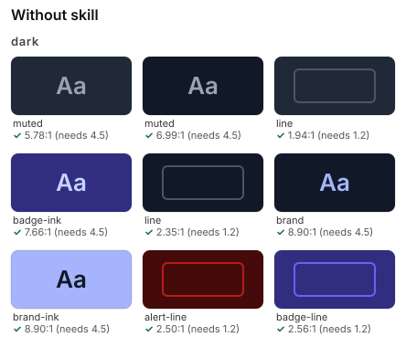

# chromagentic

Accessible, perception-based UI color for AI coding agents.

## The problem

Ask an AI agent to "add a dark mode" or "make my brand color accessible" and it will usually write hex codes by hand. They often look fine, but nobody has measured them. Text can fall short of its contrast target on a raised surface, a dark mode can feel flatter than the light one, brand hues drift, and web projects get old sRGB hex instead of wide-gamut color.

Chromagentic is a skill that fixes this. The agent describes the colors it wants, and a color engine builds them to exact contrast targets in every mode.

## What it looks like

Same prompt, "Add a dark mode", on a project that only had a light theme. ✓ means the color pair meets its contrast target.

| Original light mode | New dark mode, without the skill | New dark mode, with the skill |
|---|---|---|
|  |  |  |

More examples, including dark-to-light, button states, and mood prompts like "calm and earthy", are in the [gallery](docs/gallery/README.md).

## Measured improvement

We ran GitHub Copilot CLI on 9 typical requests across sample projects (plain CSS, Tailwind, design tokens, SwiftUI, Android Compose). Each request ran 3 times with the skill and 3 times without. The score combines contrast in every mode, the right color format and gamut for the platform, a passing build, and, where relevant, mood match and how well a new mode matches the original.

| Request | Without skill | With skill | Difference |
|---|---|---|---|
| Create a color system | 65% | 100% | +35 |
| Add dark mode | 64% | 98% | +33 |
| Add a high-contrast mode | 67% | 100% | +33 |
| Make my brand color accessible | 67% | 100% | +33 |
| Build a button with all its states | 50% | 95% | +45 |
| Bright, vivid website | 66% | 89% | +23 |
| Calm, earthy feel | 74% | 99% | +26 |
| Light mode → add dark mode | 85% | 98% | +12 |
| Dark mode → add light mode | 80% | 97% | +17 |

With the skill, new modes kept the original's contrast order and perceived contrast, and the original mode stayed the same. Details and method: [evals/README.md](evals/README.md).

## Install

```sh
npx skills add NateBaldwinDesign/Chromagentic
```

Other ways to install the same skill:

| Tool | Command |
|---|---|
| GitHub CLI | `gh skill install NateBaldwinDesign/Chromagentic chromagentic` |
| Claude Code | `/plugin marketplace add NateBaldwinDesign/Chromagentic`, then `/plugin install chromagentic@chromagentic` |
| npm | `npm install --save-dev chromagentic`, then `npx skills experimental_sync -y` |

The skill includes its own copy of the engine (`scripts/chromagentic.mjs`), so it works offline with just Node.js 20 or newer.

After that, just ask your agent for color work, for example "Create a color system for this app", "Add dark mode", or "Give my app a calm, earthy feel".

## What it does

Chromagentic gives your agent two things:

1. **A skill**: practical color knowledge for user interfaces (perception, contrast, scales, modes, accessibility, platforms), rewritten from [Color and Contrast.com](https://colorandcontrast.com).
2. **A color engine**: exact colors made from contrast targets, so your agent never has to guess. Every color has a known contrast in every mode.

Colors are measured the way people see them (OKLCH). Light, dark, high-contrast, and low-contrast modes come from a few global settings. Dark modes get extra contrast to make up for light text on dark looking weaker (polarity compensation, 10% by default). When converting an existing theme, the agent reuses its colors as key colors so the original mode keeps its look.

## Generate colors yourself

Write a settings file, for example `chromagentic.theme.json`:

```json
{
  "$schema": "https://raw.githubusercontent.com/NateBaldwinDesign/Chromagentic/main/skills/chromagentic/assets/theme.schema.json",
  "colors": { "brand": "#0265dc" },
  "modes": {
    "light": { "backgroundLightness": 1 },
    "dark": { "backgroundLightness": 0.1 }
  }
}
```

Then generate:

```sh
npx chromagentic generate chromagentic.theme.json --out src/colors.css
```

Useful options:

- `--format css|tailwind|dtcg|json`: CSS custom properties (the default), a Tailwind v4 `@theme`, design tokens (DTCG), or all the data.
- `--platform ios|android|web|email|…`: picks the right gamut and format for the platform (see below).
- `--strict`: fail instead of warning when a contrast target can't be reached.

Other commands:

```sh
npx chromagentic suggest "calm and earthy"     # candidate key colors for mood words
npx chromagentic describe "#c8a03c"            # "rich, golden and warm"
npx chromagentic contrast "#767676" "#ffffff"  # 4.54
```

See [`skills/chromagentic/assets/`](skills/chromagentic/assets) for more settings files, including all four kinds of mode and APCA.

## Settings for each mode

| Setting | What it does | Typical values |
|---|---|---|
| `backgroundLightness` | How light the background is | `1` light, `0.1` dark |
| `contrastMultiplier` | Scales every contrast target | `1` normal, `1.5`–`2` high contrast, `0.7`–`0.85` low contrast |
| `polarityCompensation` | Extra contrast on dark backgrounds (WCAG 2 only) | `0.1` (default) |

Contrast can use **WCAG 2** (the default) or **APCA** (`"formula": "apca"`).

## Platforms and gamut

| Platform | Output |
|---|---|
| Modern web CSS, Tailwind, design tokens | OKLCH, wide gamut |
| iOS, macOS, visionOS, Android Compose | Display P3 |
| Email, Flutter, React Native, older tech | sRGB hex |

## JavaScript API

```js
import { generateTheme, toCss, toDtcg, suggestColors, describeColor, contrast } from "chromagentic";

const theme = generateTheme({ colors: { brand: "#0265dc" } });
theme.modes.light.roles.text;   // { css, hex, oklch, contrast, target, ref }
theme.warnings;                 // targets that couldn't be reached, in plain words

const css = toCss(theme);       // CSS custom properties for every mode
const tokens = toDtcg(theme);   // DTCG design tokens

suggestColors("bright vivid").colors; // candidate key colors
describeColor("#c8a03c").summary;     // "rich, golden and warm"
contrast("#767676", "#fff");          // 4.54 (WCAG 2)
```

The words-to-colors data is English and written from a Western point of view. Treat it as a starting point, not a rule.

## Not included yet

Data-visualization palettes and transparent (opacity) colors.

## Development

```sh
npm install
npm test               # unit and property tests
npm run test:coverage  # coverage report (90% goal)
npm run lint && npm run typecheck && npm run build
npm run eval           # agent evals (uses AI credits; see evals/README.md)
```

## License and credits

Apache-2.0. The color engine is adapted from the Spectrum Studio color system (Copyright Adobe, Apache-2.0). Descriptive color features use [color-description](https://github.com/words/color-description) (MIT). See [NOTICE](NOTICE).
