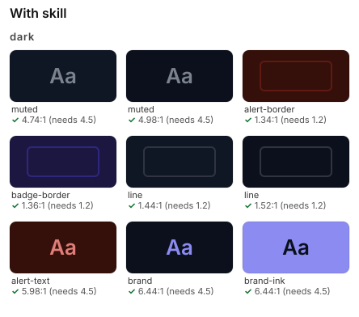
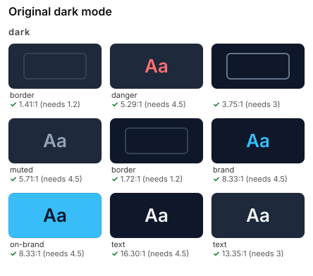
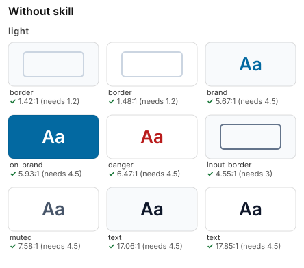
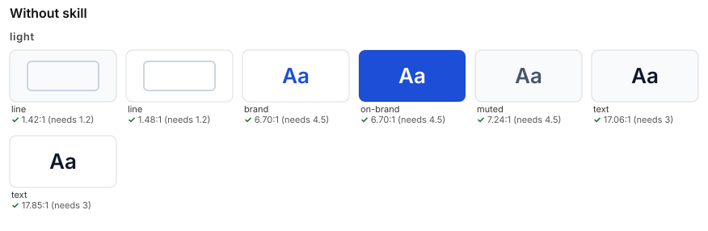
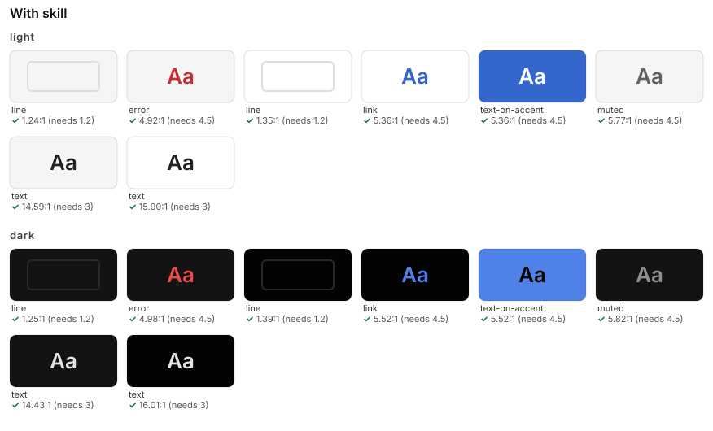
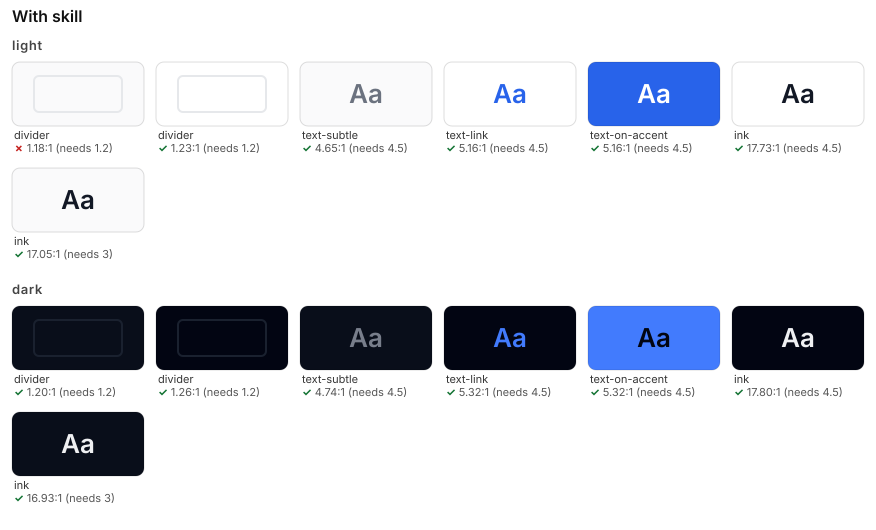
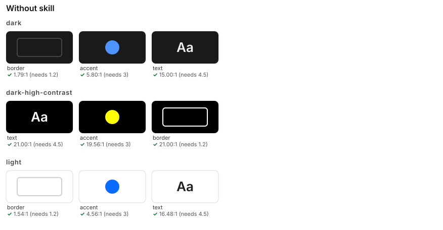
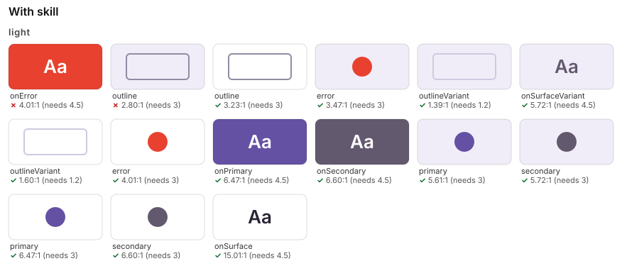
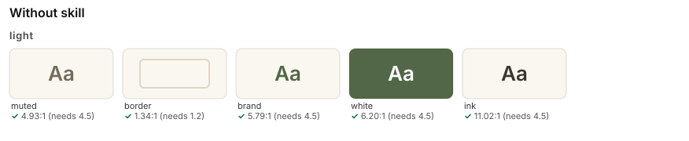
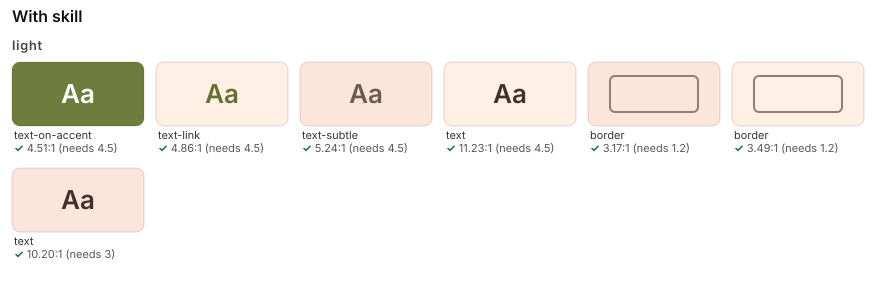

# Gallery: with and without the skill

Each scenario was run 3 times with copilot, with and without the chromagent skill, from the same prompt. The swatches show a typical run (the median score). ✓ means the pair meets its contrast target; ✗ means it doesn't. Colors are shown in sRGB so every screen can display them.

Report: 2026-11-21T21:33:22.960Z. Rebuild with `npm run gallery`.

| Scenario | Without skill | With skill | Difference |
|---|---|---|---|
| [color-system](#color-system) | 65% | 100% | +35 pts |
| [dark-mode](#dark-mode) | 64% | 98% | +33 pts |
| [high-contrast](#high-contrast) | 67% | 100% | +33 pts |
| [brand-accessible](#brand-accessible) | 67% | 100% | +33 pts |
| [button-states](#button-states) | 50% | 95% | +45 pts |
| [bright-vivid](#bright-vivid) | 66% | 89% | +23 pts |
| [calm-earthy](#calm-earthy) | 74% | 99% | +26 pts |
| [light-to-dark](#light-to-dark) | 85% | 98% | +12 pts |
| [dark-to-light](#dark-to-light) | 80% | 97% | +17 pts |

## Mode conversions

The agent gets a project with only one mode and is asked to add the other. Left to right: the original mode, the new mode without the skill, the new mode with the skill.

### light-to-dark

> Add a dark mode.

| Original (light) | New dark mode, without skill | New dark mode, with skill |
|---|---|---|
|  |  |  |

| Score | Without skill | With skill | Difference |
|---|---|---|---|
| Overall result | 85% | 98% | +12 pts |
| Contrast pass, light | 100% | 100% | +0 pts |
| Contrast pass, dark | 100% | 100% | +0 pts |
| Format and gamut fit | 0% | 100% | +100 pts |
| Builds | 100% | 100% | +0 pts |
| New mode passes | 100% | 100% | +0 pts |
| Role order kept | 97% | 100% | +3 pts |
| Perceived contrast kept | 92% | 100% | +8 pts |
| Brand hues kept | 83% | 83% | +0 pts |
| Original mode unchanged | 95% | 95% | +0 pts |
| Mode switch works | 100% | 100% | +0 pts |

### dark-to-light

> Add a light mode.

| Original (dark) | New light mode, without skill | New light mode, with skill |
|---|---|---|
|  |  |  |

| Score | Without skill | With skill | Difference |
|---|---|---|---|
| Overall result | 80% | 97% | +17 pts |
| Contrast pass, light | 100% | 100% | +0 pts |
| Contrast pass, dark | 100% | 100% | +0 pts |
| Format and gamut fit | 0% | 100% | +100 pts |
| Builds | 100% | 100% | +0 pts |
| New mode passes | 100% | 100% | +0 pts |
| Role order kept | 86% | 100% | +14 pts |
| Perceived contrast kept | 75% | 100% | +25 pts |
| Brand hues kept | 67% | 78% | +11 pts |
| Original mode unchanged | 92% | 95% | +3 pts |
| Mode switch works | 100% | 100% | +0 pts |

## New color systems

### color-system

> Create a color system for this app.

| Without skill | With skill |
|---|---|
|  |  |

| Score | Without skill | With skill | Difference |
|---|---|---|---|
| Overall result | 65% | 100% | +35 pts |
| Contrast pass, light | 96% | 100% | +4 pts |
| Format and gamut fit | 0% | 100% | +100 pts |
| Builds | 100% | 100% | +0 pts |

### dark-mode

> Add dark mode.

| Without skill | With skill |
|---|---|
|  |  |

| Score | Without skill | With skill | Difference |
|---|---|---|---|
| Overall result | 64% | 98% | +33 pts |
| Contrast pass, light | 86% | 86% | -1 pts |
| Contrast pass, dark | 100% | 100% | +0 pts |
| Format and gamut fit | 0% | 100% | +100 pts |
| Builds | 100% | 100% | +0 pts |

### high-contrast

> Add a high-contrast mode.

| Without skill | With skill |
|---|---|
|  |  |

| Score | Without skill | With skill | Difference |
|---|---|---|---|
| Overall result | 67% | 100% | +33 pts |
| Contrast pass, light | 100% | 100% | +0 pts |
| Contrast pass, dark | 100% | 100% | +0 pts |
| Contrast pass, high contrast | 100% | 100% | +0 pts |
| Format and gamut fit | 0% | 100% | +100 pts |
| Builds | 100% | 100% | +0 pts |

### brand-accessible

> Make my brand color #FF5A00 accessible.

| Without skill | With skill |
|---|---|
|  |  |

| Score | Without skill | With skill | Difference |
|---|---|---|---|
| Overall result | 67% | 100% | +33 pts |
| Contrast pass, light | 100% | 100% | +0 pts |
| Format and gamut fit | 0% | 100% | +100 pts |
| Builds | 100% | 100% | +0 pts |

### button-states

> Build a button with all its states.

| Without skill | With skill |
|---|---|
|  |  |

| Score | Without skill | With skill | Difference |
|---|---|---|---|
| Overall result | 50% | 95% | +45 pts |
| Contrast pass, light | 100% | 90% | -10 pts |
| Format and gamut fit | 0% | 100% | +100 pts |

### bright-vivid

> Make a website with bright vivid colors.

| Without skill | With skill |
|---|---|
|  |  |

| Score | Without skill | With skill | Difference |
|---|---|---|---|
| Overall result | 66% | 89% | +23 pts |
| Contrast pass, light | 74% | 100% | +26 pts |
| Format and gamut fit | 0% | 100% | +100 pts |
| Mood match | 92% | 57% | -35 pts |
| Builds | 100% | 100% | +0 pts |

### calm-earthy

> Give my app a calm, earthy feel.

| Without skill | With skill |
|---|---|
|  |  |

| Score | Without skill | With skill | Difference |
|---|---|---|---|
| Overall result | 74% | 99% | +26 pts |
| Contrast pass, light | 95% | 100% | +5 pts |
| Format and gamut fit | 0% | 100% | +100 pts |
| Mood match | 100% | 97% | -3 pts |
| Builds | 100% | 100% | +0 pts |
