# Gallery: with and without the skill

Each scenario was run 3 times with copilot, with and without the chromagentic skill, from the same prompt. The swatches show a typical run (the median score). ✓ means the pair meets its contrast target; ✗ means it doesn't. Colors are shown in sRGB so every screen can display them.

Report: 2026-11-22T20:21:08.547Z. Rebuild with `npm run gallery`.

| Scenario | Without skill | With skill | Difference |
|---|---|---|---|
| [color-system](#color-system) | 67% | 100% | +33 pts |
| [dark-mode](#dark-mode) | 64% | 97% | +33 pts |
| [high-contrast](#high-contrast) | 67% | 100% | +33 pts |
| [brand-accessible](#brand-accessible) | 67% | 100% | +33 pts |
| [button-states](#button-states) | 47% | 100% | +53 pts |
| [bright-vivid](#bright-vivid) | 60% | 88% | +28 pts |
| [calm-earthy](#calm-earthy) | 67% | 100% | +33 pts |
| [light-to-dark](#light-to-dark) | 85% | 96% | +11 pts |
| [dark-to-light](#dark-to-light) | 80% | 95% | +15 pts |
| [role-first](#role-first) | 80% | 100% | +20 pts |
| [form-validation](#form-validation) | 76% | 100% | +24 pts |
| [personalization](#personalization) | 69% | 100% | +31 pts |
| [six-schemes](#six-schemes) | 50% | 80% | +30 pts |

## Mode conversions

The agent gets a project with only one mode and is asked to add the other. Left to right: the original mode, the new mode without the skill, the new mode with the skill.

### light-to-dark

> Add a dark mode.

| Original (light) | New dark mode, without skill | New dark mode, with skill |
|---|---|---|
| 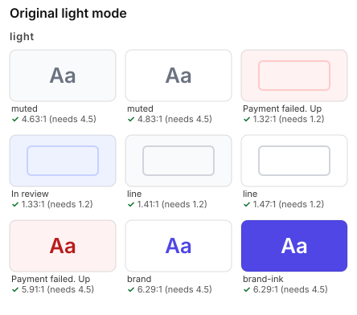 | 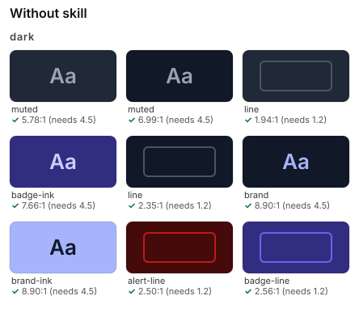 |  |

| Score | Without skill | With skill | Difference |
|---|---|---|---|
| Overall result | 85% | 96% | +11 pts |
| Contrast pass, light | 100% | 98% | -2 pts |
| Contrast pass, dark | 100% | 98% | -2 pts |
| Format and gamut fit | 0% | 100% | +100 pts |
| Builds | 100% | 100% | +0 pts |
| New mode passes | 100% | 98% | -2 pts |
| Role order kept | 97% | 98% | +1 pts |
| Perceived contrast kept | 92% | 97% | +5 pts |
| Brand hues kept | 83% | 83% | +0 pts |
| Original mode unchanged | 95% | 93% | -2 pts |
| Mode switch works | 100% | 100% | +0 pts |

### dark-to-light

> Add a light mode.

| Original (dark) | New light mode, without skill | New light mode, with skill |
|---|---|---|
|  |  | 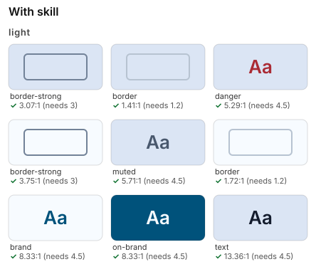 |

| Score | Without skill | With skill | Difference |
|---|---|---|---|
| Overall result | 80% | 95% | +15 pts |
| Contrast pass, light | 100% | 100% | +0 pts |
| Contrast pass, dark | 100% | 100% | +0 pts |
| Format and gamut fit | 0% | 100% | +100 pts |
| Builds | 100% | 100% | +0 pts |
| New mode passes | 100% | 100% | +0 pts |
| Role order kept | 86% | 100% | +14 pts |
| Perceived contrast kept | 75% | 100% | +25 pts |
| Brand hues kept | 67% | 67% | +0 pts |
| Original mode unchanged | 92% | 92% | +0 pts |
| Mode switch works | 100% | 100% | +0 pts |

## New color systems

### color-system

> Create a color system for this app.

| Without skill | With skill |
|---|---|
|  |  |

| Score | Without skill | With skill | Difference |
|---|---|---|---|
| Overall result | 67% | 100% | +33 pts |
| Contrast pass, light | 100% | 100% | +0 pts |
| Format and gamut fit | 0% | 100% | +100 pts |
| Builds | 100% | 100% | +0 pts |

### dark-mode

> Add dark mode.

| Without skill | With skill |
|---|---|
| 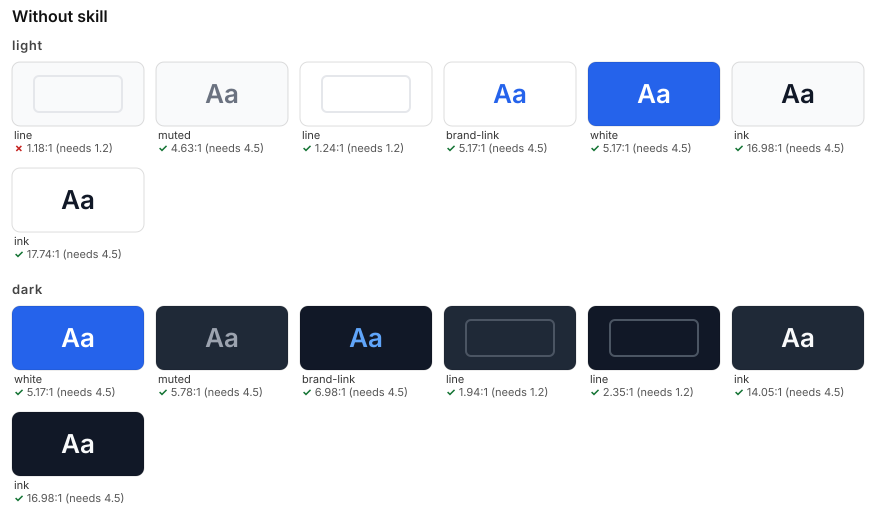 |  |

| Score | Without skill | With skill | Difference |
|---|---|---|---|
| Overall result | 64% | 97% | +33 pts |
| Contrast pass, light | 87% | 87% | +0 pts |
| Contrast pass, dark | 100% | 96% | -4 pts |
| Format and gamut fit | 0% | 100% | +100 pts |
| Builds | 100% | 100% | +0 pts |

### high-contrast

> Add a high-contrast mode.

| Without skill | With skill |
|---|---|
|  | 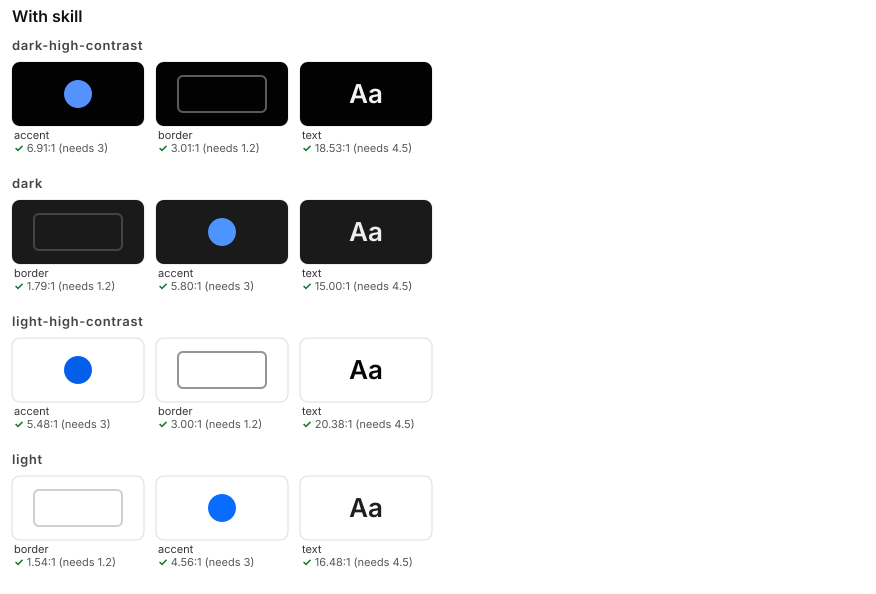 |

| Score | Without skill | With skill | Difference |
|---|---|---|---|
| Overall result | 67% | 100% | +33 pts |
| Contrast pass, light | 100% | 100% | +0 pts |
| Contrast pass, dark | 100% | 100% | +0 pts |
| Contrast pass, high contrast | 100% | 100% | +0 pts |
| Format and gamut fit | 0% | 100% | +100 pts |
| Builds | 100% | 100% | +0 pts |

### brand-accessible

> Make my brand color #FF5A00 accessible.

| Without skill | With skill |
|---|---|
| 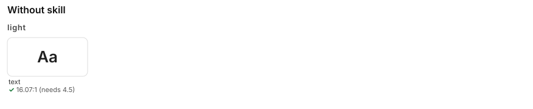 | 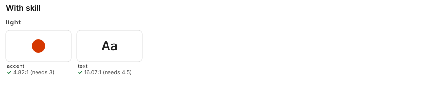 |

| Score | Without skill | With skill | Difference |
|---|---|---|---|
| Overall result | 67% | 100% | +33 pts |
| Contrast pass, light | 100% | 100% | +0 pts |
| Format and gamut fit | 0% | 100% | +100 pts |
| Builds | 100% | 100% | +0 pts |

### button-states

> Build a button with all its states.

| Without skill | With skill |
|---|---|
| 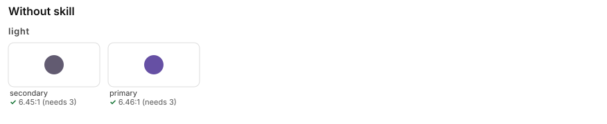 |  |

| Score | Without skill | With skill | Difference |
|---|---|---|---|
| Overall result | 47% | 100% | +53 pts |
| Contrast pass, light | 94% | 100% | +6 pts |
| Format and gamut fit | 0% | 100% | +100 pts |

### bright-vivid

> Make a website with bright vivid colors.

| Without skill | With skill |
|---|---|
| 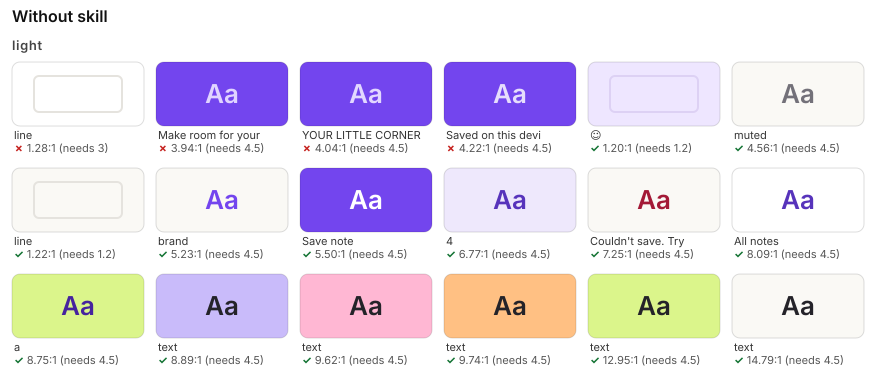 | 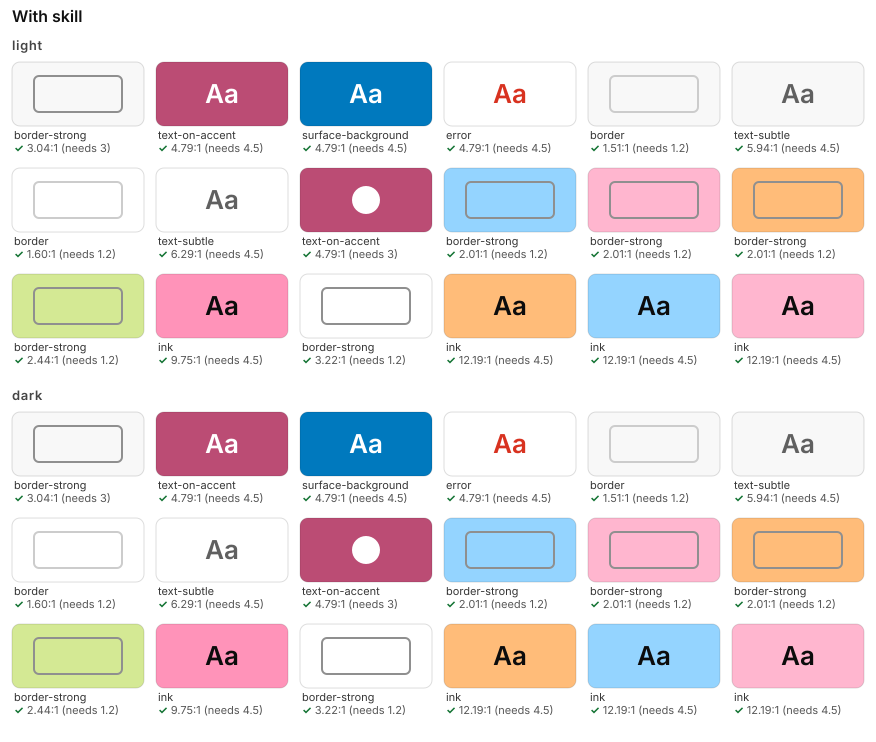 |

| Score | Without skill | With skill | Difference |
|---|---|---|---|
| Overall result | 60% | 88% | +28 pts |
| Contrast pass, light | 64% | 99% | +34 pts |
| Format and gamut fit | 0% | 100% | +100 pts |
| Mood match | 76% | 54% | -22 pts |
| Builds | 100% | 100% | +0 pts |

### calm-earthy

> Give my app a calm, earthy feel.

| Without skill | With skill |
|---|---|
|  |  |

| Score | Without skill | With skill | Difference |
|---|---|---|---|
| Overall result | 67% | 100% | +33 pts |
| Contrast pass, light | 100% | 100% | +0 pts |
| Format and gamut fit | 0% | 100% | +100 pts |
| Mood match | 67% | 100% | +33 pts |
| Builds | 100% | 100% | +0 pts |

### role-first

> Pick the colors for this app.

| Without skill | With skill |
|---|---|
| 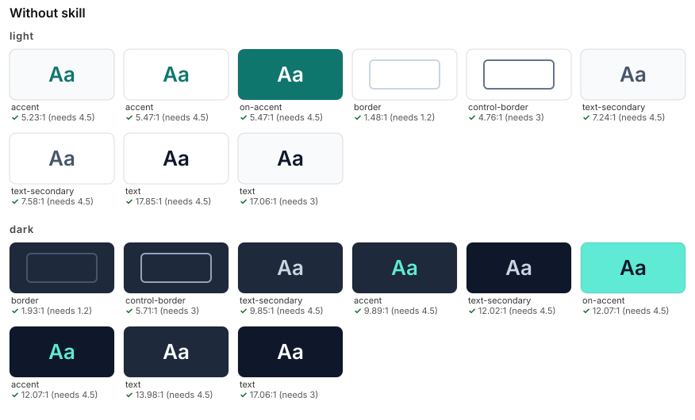 | 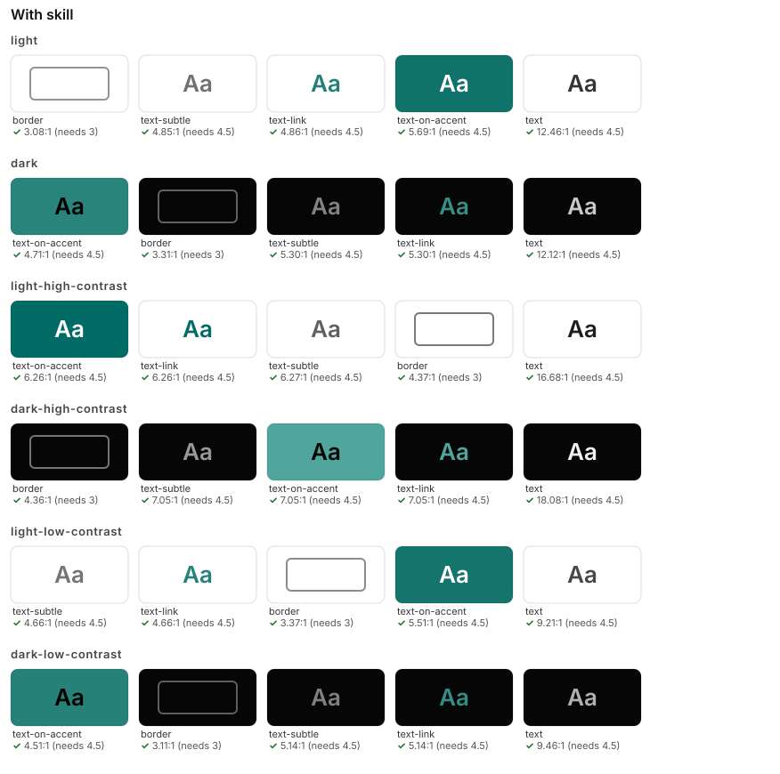 |

| Score | Without skill | With skill | Difference |
|---|---|---|---|
| Overall result | 80% | 100% | +20 pts |
| Contrast pass, light | 100% | 100% | +0 pts |
| Contrast pass, dark | 100% | 100% | +0 pts |
| Format and gamut fit | 0% | 100% | +100 pts |
| Builds | 100% | 100% | +0 pts |
| Roles, not a full scale | 100% | 100% | +0 pts |
| Text tiers fit | 100% | 100% | +0 pts |

### form-validation

> Give the info, error, warning, and success messages on this sign-up form their own colors.

| Without skill | With skill |
|---|---|
| 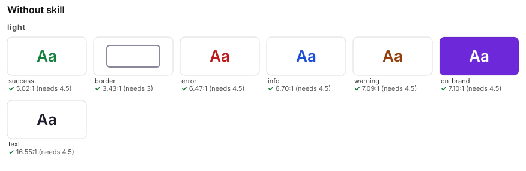 | 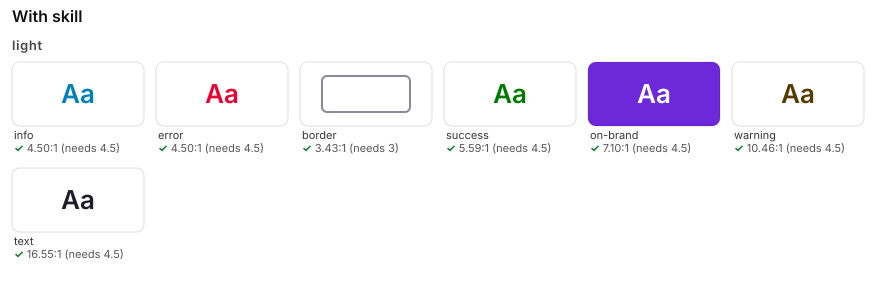 |

| Score | Without skill | With skill | Difference |
|---|---|---|---|
| Overall result | 76% | 100% | +24 pts |
| Contrast pass, light | 100% | 100% | +0 pts |
| Format and gamut fit | 0% | 100% | +100 pts |
| Builds | 100% | 100% | +0 pts |
| Feedback distinct in color-blind views | 79% | 100% | +21 pts |
| Feedback matches brand | 100% | 100% | +0 pts |

### personalization

> Let people personalize this app's colors. They should be able to choose how light or dark it is and how much contrast they want, and the app should remember their choice.

| Without skill | With skill |
|---|---|
| 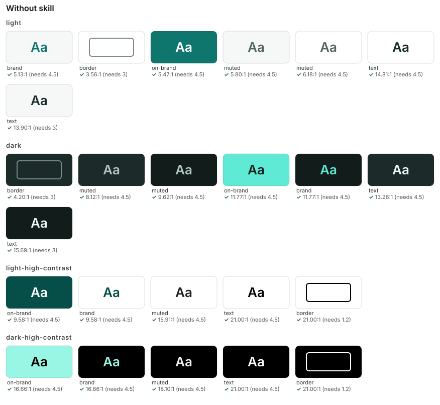 | 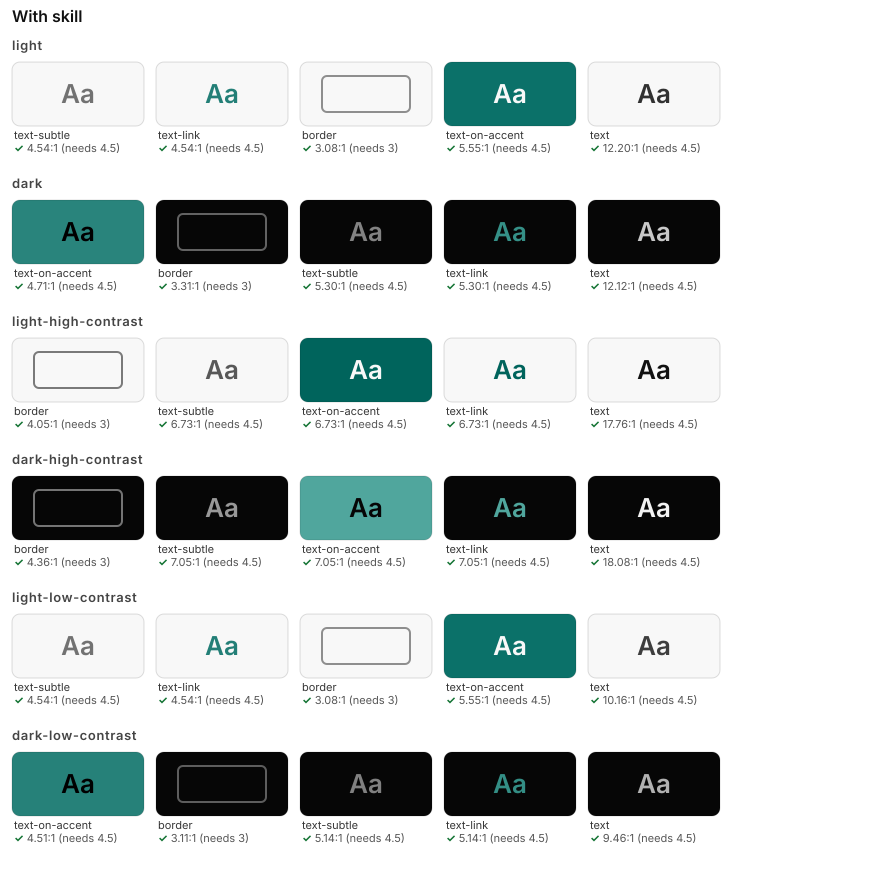 |

| Score | Without skill | With skill | Difference |
|---|---|---|---|
| Overall result | 69% | 100% | +31 pts |
| Contrast pass, light | 100% | 100% | +0 pts |
| Contrast pass, dark | 100% | 100% | +0 pts |
| Format and gamut fit | 0% | 98% | +98 pts |
| Builds | 100% | 100% | +0 pts |
| Personal colors work | 75% | 100% | +25 pts |

### six-schemes

> Set up the color themes for this new app.

| Without skill | With skill |
|---|---|
| 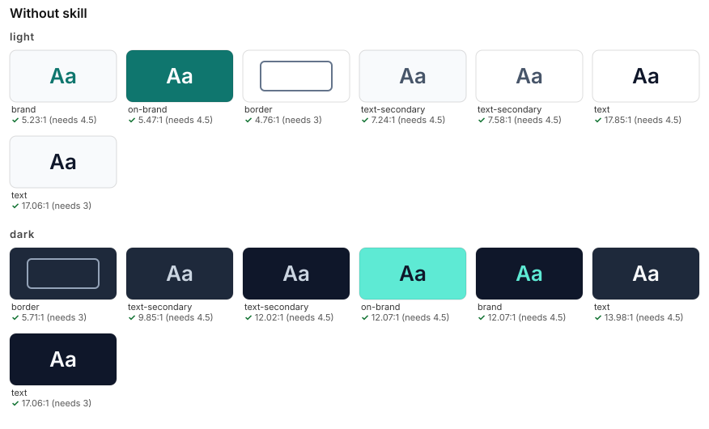 |  |

| Score | Without skill | With skill | Difference |
|---|---|---|---|
| Overall result | 50% | 80% | +30 pts |
| Contrast pass, light | 100% | 100% | +0 pts |
| Contrast pass, dark | 100% | 100% | +0 pts |
| Contrast pass, high contrast | 0% | 100% | +100 pts |
| Contrast pass, low contrast | 0% | 100% | +100 pts |
| Format and gamut fit | 0% | 100% | +100 pts |
| Builds | 100% | 100% | +0 pts |
| Uses the app's theme switch | 100% | 100% | +0 pts |
| Asked about personal colors | 0% | 0% | +0 pts |
